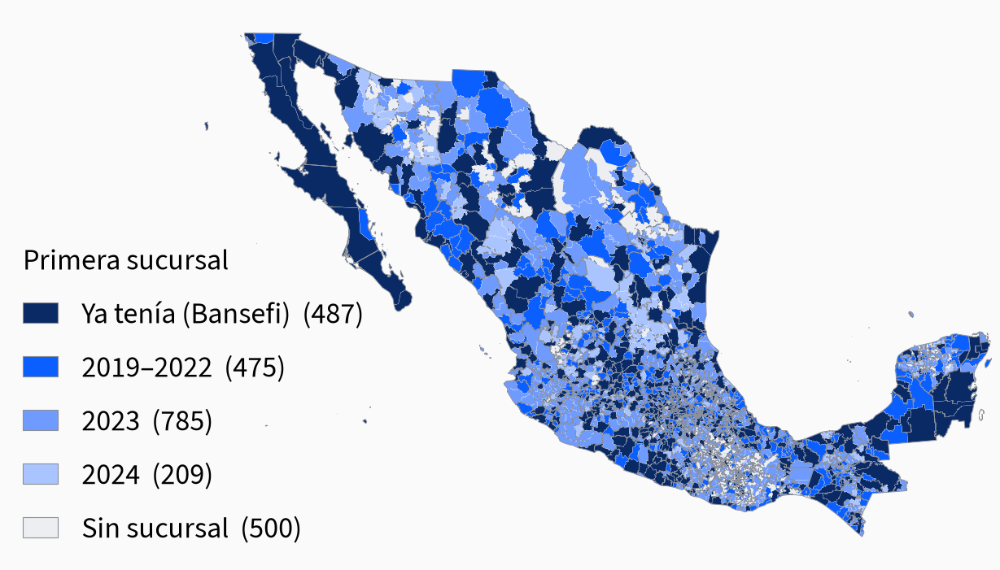
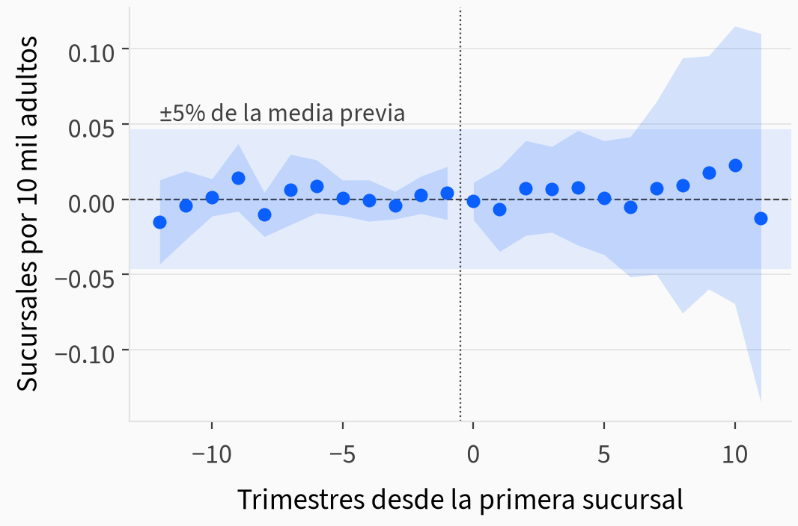

# ¿Atrajo o desplazó? El Banco del Bienestar y la banca privada en los municipios

Evaluación causal del Plan de Expansión del Banco del Bienestar. Entre 2019 y 2024 el banco pasó de
540 a 3,149 sucursales, casi todas abiertas de forma escalonada entre 2022 y 2024. ¿La primera
sucursal de un municipio atrajo o desplazó a la banca múltiple y a las entidades de ahorro y crédito
popular (SOCAP y SOFIPO)?

Proyecto de Andrés Álvarez Flores, Fernando Barba y Luis Islas (ITAM, otoño de 2026) para dos
materias: **Tópicos de Política Pública II** y **Ciencia de Datos Aplicada II**.

**[Aplicación web](https://andresaf03.github.io/banco-bienestar/)** ·
**[Trabajo final (PDF)](entregables/renderizados/trabajo_final.pdf)** ·
**[Presentación de Política Pública](entregables/renderizados/presentacion_ppii.pdf)** ·
**[Presentación de Ciencia de Datos](entregables/renderizados/presentacion_cdaii.pdf)** ·
**[Guía completa](GUIA.md)**



## La respuesta corta

1. **El banco sí llegó y bancarizó.** La primera sucursal suma +2.00 sucursales por 10 mil adultos
   (ee 0.08) y +3,284 tarjetas de débito del banco por 10 mil adultos, con previos planos.
2. **No atrajo ni desplazó a la banca privada.** Sucursales privadas +0.007 por 10 mil adultos
   (ee 0.009), +0.7% de la media previa; banca múltiple −0.2% y EACP +1.5%. Una prueba de efecto
   inyectado muestra que el diseño detecta un efecto de ±5% entre 90% y 98% de las veces: se
   descartan efectos mayores a ±5%. Con otros grupos de control (solo nunca tratados, solo los que
   abren, emparejados) el centro va de −1.9% a +2.3%.
3. **Las cuentas casi no dan crédito.** Donde abre, el banco suma +1,316 contratos de captación y
   +6.2 créditos por 10 mil adultos (exploratorio). En 2025T4 tenía 0.5 créditos por cada 100
   cuentas, contra 61 en la banca múltiple.
4. **Acercó el cobro de los programas.** Los adultos de 65 años o más pasaron de 9.5 km a 2.9 km de
   una sucursal del banco, y los que viven a 10 km o menos, de 68% a 92% (en los municipios de
   marginación muy alta, de 26% a 78%). Si llegaron *más* programas no se puede saber con datos
   públicos: el padrón por municipio y periodo solo existe como listas de personas.
5. **Un aumento del DENUE que no se puede atribuir.** Los establecimientos suben 10.4% en las
   localidades con sucursal, y más del 90% del aumento queda a menos de 3 km de ella. Pero no se
   concentra en el comercio, no crece con la antigüedad de la sucursal ni con los adultos mayores, y
   no aparece en los Censos Económicos (−0.9%) ni en la Encuesta Intercensal. Con la regla
   preregistrada, no se distingue entre gasto de los programas y medición del padrón.



## Dos materias, un proyecto

| Materia | Qué hay | Dónde |
|---|---|---|
| Tópicos de Política Pública II | Propuesta, metodología, trabajo final y presentación de 14 láminas | `entregables/01_propuesta/` a `04_final/` y `06_politica_publica/` |
| Ciencia de Datos Aplicada II | Aplicación web (mapa, resultados, pruebas y un laboratorio que vuelve a estimar Callaway y Sant'Anna en el navegador) y presentación de 10 láminas | `app/` y `entregables/05_ciencia_datos/` |

Documentos listos para leer, en `entregables/renderizados/`:

| Archivo | Materia | Qué es |
|---|---|---|
| [`trabajo_final.pdf`](entregables/renderizados/trabajo_final.pdf) | PPII | Trabajo final (versión de noviembre; se entrega el 7 de diciembre de 2026) |
| [`metodologia.pdf`](entregables/renderizados/metodologia.pdf) | PPII | Descripción de la metodología |
| [`propuesta_v1_entregada.pdf`](entregables/01_propuesta/propuesta_v1_entregada.pdf) | PPII | Propuesta |
| [`presentacion_ppii.pdf`](entregables/renderizados/presentacion_ppii.pdf) (y `.pptx`) | PPII | Presentación de 12 minutos con notas del presentador, tal como se dio el 17 de noviembre; el trabajo final incorpora los comentarios de esa sesión (acceso al cobro y una lectura más fina del DENUE) |
| [`presentacion_cdaii.pdf`](entregables/renderizados/presentacion_cdaii.pdf) (y `.pptx`) | CDA II | Presentación de la aplicación |

Los PDF y los `.pptx` se generan desde las fuentes del repositorio (`make entregables`,
`make presentacion-ppii`, `make presentacion-cdaii`).

## Diseño

- **Unidad y periodo.** Municipio por trimestre, 2019T1–2024T4 (hasta 2025T4 en las ampliaciones),
  con 2,456 municipios. Para la actividad local, localidad entre actualizaciones integrales del DENUE.
- **Tratamiento.** Primer trimestre con una sucursal del Banco del Bienestar **operando** según la
  CNBV (no la fecha de obra), sin Banjército. 1,457 municipios tratados contra 500 sin sucursal.
- **Resultado principal.** Sucursales privadas (banca múltiple más EACP) por 10 mil adultos, con
  denominador fijo en 2022T4. El propio banco queda fuera: sus cuentas suben por construcción.
- **Estimador.** Diferencias en diferencias escalonadas de Callaway y Sant'Anna (2021), doblemente
  robusto, contra municipios aún no tratados y nunca tratados, con población, marginación y banca
  previa como covariables. Errores estándar agrupados por municipio sobre la función de influencia.
- **Inferencia.** Prueba de previos (Wald conjunta), Romano–Wolf en las familias preregistradas,
  equivalencia (TOST, ±5% de la media previa), HonestDiD y una prueba de efecto inyectado (Bertrand,
  Duflo y Mullainathan, 2004) para medir qué tan chico es el efecto que el diseño alcanza a ver.
- **Contrastes.** TWFE, Sun y Abraham, Borusyak, Jaravel y Spiess, TWFE extendido de Wooldridge, DiD
  apilado, Goodman-Bacon, placebo de fecha, permutación, derrames en vecinos y sin un estado a la vez.

Las especificaciones y las reglas de decisión se fijaron antes de correr (`docs/decisiones.md`).
Lo que reprueba la prueba de previos se reporta como descriptivo.

## Datos

El repositorio **no incluye datos**: pesan varios gigabytes (solo el DENUE histórico, 13 GB). `make descargar` los baja de las
fuentes oficiales y registra cada archivo con su sha256 en `data/raw/MANIFEST.csv`. Las URL y el
estado de cada fuente están en `config/fuentes.yaml`; las que bloquean clientes automáticos se bajan a
mano siguiendo `docs/descarga_manual.md`.

| Fuente | Para qué |
|---|---|
| CNBV, Base de Datos de Inclusión Financiera (BDIF) | Sucursales, contratos, tarjetas, cajeros y TPV por sector, municipio y trimestre |
| CNBV, Portafolio de Información | Separar al Banco del Bienestar de Banjército |
| Banco del Bienestar, directorio de sucursales | Ubicación de cada sucursal |
| INEGI: DENUE, Censos Económicos, Censo 2020, Encuesta Intercensal, Marco Geoestadístico, ENOE, ENIGH, EFIPEM | Actividad local, población, covariables y límites |
| CONAPO | Índice de marginación y proyecciones de población |
| IMSS, Banxico, SESNSP, INE, VIIRS (Zenodo) | Empleo formal, remesas, delitos, elecciones y luz nocturna |
| Secretaría de Bienestar (Padrón Único de Beneficiarios, agregado municipal); INEGI y CNBV (ENIF 2021 y 2024) | Beneficiarios por municipio y acceso al cobro de los programas |

Las tablas derivadas sí están: estimaciones en `outputs/tablas/`, figuras en `outputs/figuras/` y los
datos agregados de la aplicación en `app/public/datos/`.

## Reproducir

Requisitos: Python 3.12 con [uv](https://docs.astral.sh/uv/), R 4.4 o más reciente (los paquetes
los instala `renv`), Quarto para los PDF, Node 18 o más reciente para la aplicación y los decks, y
`make`.

```bash
make setup         # entorno de Python (uv) y paquetes de R (renv)
make descargar     # descargas idempotentes; FORCE=1 para volver a bajar
make limpiar       # data/interim/*.parquet y docs/diccionarios/
make panel         # paneles en data/processed/
make bateria       # corrida preregistrada completa (~55 min)
make bateria-fase6 # acceso al cobro, ENIF y pruebas del DENUE de la fase 6 (~3 min)
make entregables   # figuras, tablas, trabajo_final.pdf y presentación
make test          # pytest
```

Las descargas se identifican con un user-agent del proyecto. Para que incluya un correo de contacto,
define `PROYECTO_CONTACTO` antes de descargar:

```bash
export PROYECTO_CONTACTO="tu-correo@ejemplo.org"
```

La aplicación no necesita R ni Python, porque sus datos ya vienen en `app/public/datos/`:

```bash
cd app && npm ci && npm run dev
```

En macOS, si `git` o `make` fallan por la licencia de Xcode, usa los binarios de
`/Library/Developer/CommandLineTools/usr/bin/` o acepta la licencia con `sudo xcodebuild -license accept`.

## Estructura

```
config/          fuentes.yaml (URL y estado de cada fuente) · parametros.yaml (periodo, umbrales, semillas)
data/            raw/ · manual/ · interim/ · processed/            [sin datos; solo MANIFEST.csv]
src/proyecto/    descarga/ · limpieza/ · construccion/ · variables/ · utils/   (Python)
analisis/        00_utils … 16_fase6                                            (R)
outputs/         tablas/ (estimaciones en CSV) · figuras/
entregables/     01_propuesta … 06_politica_publica · _tablas/ · renderizados/ (PDF y pptx)
app/             aplicación web (Vite, React, MapLibre, Observable Plot)
docs/            decisiones.md · data_audit.md · descarga_manual.md · diccionarios/ · contexto/
tests/           pytest
GUIA.md          guía completa: datos, diseño, resultados, problemas y preguntas probables
```

## Documentación

- [`GUIA.md`](GUIA.md): todo el proyecto en un solo documento.
- [`docs/contexto/preguntas_defensa.md`](docs/contexto/preguntas_defensa.md): las preguntas probables,
  con la cifra y dónde está cada respuesta.
- [`docs/decisiones.md`](docs/decisiones.md): preregistro, adendas y decisiones con fecha.
- [`docs/data_audit.md`](docs/data_audit.md): qué permiten los datos y qué no.
- [`docs/diccionarios/`](docs/diccionarios/): variables de cada fuente y de cada panel.
- [`app/README.md`](app/README.md): secciones de la aplicación y cómo correrla.

## Licencia

El código está bajo la licencia [MIT](LICENSE). Los textos, figuras, tablas, presentaciones y PDF
están bajo [CC BY 4.0](LICENSE-CONTENIDO.md). Los datos de origen no se incluyen y cada fuente
conserva sus propios términos de uso.
