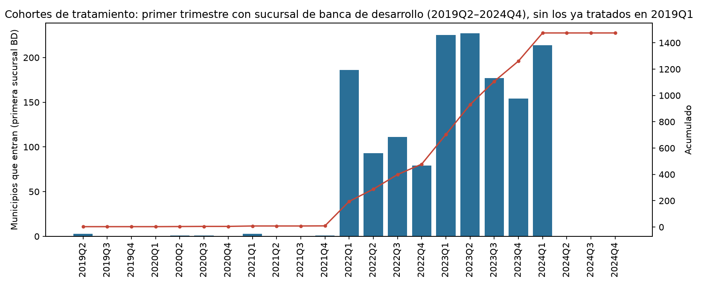

# Auditoría de datos

Generado por `python -m proyecto.utils.auditoria` el 2026-09-26. Panel objetivo: 2019Q1–2024Q4 (24 trimestres); BDIF descargada 2016T1–2025T4. Leyenda: 🟢 sin problema, 🟡 atención, 🔴 bandera roja para el diseño.

## Resumen de banderas rojas

- 🔴 **P1.** Contratos de captación/crédito, cajeros, TPV y transacciones solo se separan por sector desde 2022T4. Antes vienen como 'Banca' (múltiple + desarrollo). Sucursales sí se separan en todo el periodo → el tratamiento se puede fechar, pero los resultados 'sin Banco del Bienestar' solo existen 9 trimestres del panel.
- 🟡 **P2.** Banjército no es identificable en la BDIF municipal, pero el Portafolio de Información de la CNBV lo separa por municipio (2016-01 – 2021-12). Serie corregida `sucursales_bienestar.parquet`: 12 municipios 'solo Banjército', 5 cohortes con G falso, 8 sospechosos residuales (2022+).
- 🔴 **P4.** Población adulta = 15+, no 18+; y el denominador salta de proyección CONAPO a Censo 2020 fijo en 2022T4.
- 🔴 **P11.** Corresponsales: cambios de metodología en 2019T1 y 2024T1; sin sector.
- 🟡 **P3, P8, P12.** EACP con productos distintos a la banca; pocos cierres; escalón de Compartamos en banca múltiple en 2019T1; municipios nuevos.

## 1. Separación por sector (banca de desarrollo vs banca múltiple)

**Respuesta corta.** Sí para **sucursales** en los 40 trimestres (2016T1–2025T4): la BDIF trae `Sucursales banca de desarrollo` y `Sucursales banca comercial` (múltiple) como columnas separadas en todas las eras de layout. 🔴 **No** para el resto de las variables de resultado antes de 2022T4: cajeros, TPV, transacciones, cuentas de banca móvil y **todos los contratos de captación y de crédito** vienen para "Banca (comercial y de desarrollo)" combinada en 2016T1–2022T3 y solo se separan por sector (banca múltiple / banca de desarrollo / SOCAP / SOFIPO) a partir de **2022T4** (13 trimestres, 2022T4–2025T4). Los **corresponsales** nunca se separan (solo total de todos los sectores).

Implicación: el **tratamiento** (primera sucursal de banca de desarrollo) se puede fechar en todo el panel; los **resultados "solo banca múltiple y EACP"** solo se observan directamente en 2022T4–2024T4 (9 trimestres del panel propuesto). Para 2019T1–2022T3 el dato disponible es banca total (múltiple + desarrollo), que incluye al Banco del Bienestar (efecto mecánico). Ver alternativas en la sección final.

Cobertura por variable y sector (primer–último trimestre y número de trimestres con dato):

| variable de resultado | canónica | banca_desarrollo | banca_multiple | banca (combinada) | veredicto |
|---|---|---|---|---|---|
| sucursales | `sucursales` | 2016Q1–2025Q4 (40) | 2016Q1–2025Q4 (40) | — | 🟢 separable todo el panel |
| cajeros | `cajeros` | 2022Q4–2025Q4 (13) | 2022Q4–2025Q4 (13) | — | 🔴 separable solo desde 2022Q4; antes solo 'banca' = múltiple + desarrollo |
| TPV | `tpv` | 2022Q4–2025Q4 (13) | 2022Q4–2025Q4 (13) | — | 🔴 separable solo desde 2022Q4; antes solo 'banca' = múltiple + desarrollo |
| establecimientos con TPV | `establecimientos_tpv` | 2022Q4–2025Q4 (13) | 2022Q4–2025Q4 (13) | — | 🔴 separable solo desde 2022Q4; antes solo 'banca' = múltiple + desarrollo |
| corresponsales | `corresponsales` | — | — | — | 🔴 nunca separable por sector (solo total) |
| cuentas/contratos banca móvil | `cuentas_celular` | 2022Q4–2025Q4 (13) | 2022Q4–2025Q4 (13) | — | 🔴 separable solo desde 2022Q4; antes solo 'banca' = múltiple + desarrollo |
| transacciones en cajeros | `transacciones_cajeros` | 2022Q4–2025Q4 (13) | 2022Q4–2025Q4 (13) | 2016Q1–2022Q3 (27) | 🔴 separable solo desde 2022Q4; antes solo 'banca' = múltiple + desarrollo |
| transacciones en TPV | `transacciones_tpv` | 2022Q4–2025Q4 (13) | 2022Q4–2025Q4 (13) | 2016Q1–2022Q3 (27) | 🔴 separable solo desde 2022Q4; antes solo 'banca' = múltiple + desarrollo |
| contratos de captación (ahorro) | `capt_ahorro` | 2022Q4–2025Q4 (13) | 2022Q4–2025Q4 (13) | 2016Q1–2025Q4 (40) | 🔴 separable solo desde 2022Q4; antes solo 'banca' = múltiple + desarrollo |
| contratos de captación (transaccionales N1) | `capt_n1` | 2022Q4–2025Q4 (13) | 2022Q4–2025Q4 (13) | 2016Q1–2025Q4 (40) | 🔴 separable solo desde 2022Q4; antes solo 'banca' = múltiple + desarrollo |
| contratos de captación (total) | `capt_total` | 2022Q4–2025Q4 (13) | 2022Q4–2025Q4 (13) | — | 🔴 separable solo desde 2022Q4; antes solo 'banca' = múltiple + desarrollo |
| tarjetas de débito | `tarjetas_debito` | 2022Q4–2025Q4 (13) | 2022Q4–2025Q4 (13) | 2016Q1–2025Q4 (40) | 🔴 separable solo desde 2022Q4; antes solo 'banca' = múltiple + desarrollo |
| contratos de crédito (personal) | `cred_personal` | 2022Q4–2025Q4 (13) | 2022Q4–2025Q4 (13) | 2016Q1–2025Q4 (40) | 🔴 separable solo desde 2022Q4; antes solo 'banca' = múltiple + desarrollo |
| contratos de crédito (hipotecario) | `cred_hipotecario` | 2022Q4–2025Q4 (13) | 2022Q4–2025Q4 (13) | 2016Q1–2025Q4 (40) | 🔴 separable solo desde 2022Q4; antes solo 'banca' = múltiple + desarrollo |
| tarjetas de crédito | `tarjetas_credito` | 2022Q4–2025Q4 (13) | 2022Q4–2025Q4 (13) | 2016Q1–2025Q4 (40) | 🔴 separable solo desde 2022Q4; antes solo 'banca' = múltiple + desarrollo |
| contratos de crédito (total) | `cred_total` | 2022Q4–2025Q4 (13) | 2022Q4–2025Q4 (13) | — | 🔴 separable solo desde 2022Q4; antes solo 'banca' = múltiple + desarrollo |

Tabla completa (todas las variables × sectores): `outputs/tablas/auditoria_p1_cobertura_sector_variable.csv`. Evidencia de nombres de columna por era: `docs/diccionarios/cnbv_bdif.md`, sección "Encabezados originales por variable canónica".

## 2. Banjercito

**Respuesta corta.** En la BDIF municipal **no**: el sector "Banca de desarrollo" suma Banco del Bienestar y Banjército sin columna de institución (nota 1 de los reportes CNBV). **Pero sí se puede separar con otra fuente de la propia CNBV**: el Portafolio de Información publica `BD_Operativa_YYYYMM.xlsx` con sucursales **por institución y localidad INEGI** para 2016-01 a 2021-12 (`data/raw/cnbv_portafolio/`, 72 meses; la CNBV etiqueta al banco como "Bansefi" hasta 2021-07). El total Bienestar + Banjército del Portafolio **cuadra exactamente** con la banca de desarrollo de la BDIF en cada trimestre (2020T2 difiere por una revisión posterior de la CNBV) y municipio por municipio (0 diferencias en 2016T1–2020T1; 2 municipios en 2020T3–2021T4 por cambios de clave, p. ej. Villa Corzo/El Parral):

| periodo | bdif_banca_desarrollo | portafolio_bienestar+banjercito |
|---|---|---|
| 2016Q1 | 601 | 601 |
| 2016Q2 | 601 | 601 |
| 2016Q3 | 588 | 588 |
| 2016Q4 | 588 | 588 |
| 2017Q1 | 589 | 589 |
| 2017Q2 | 600 | 600 |
| 2017Q3 | 600 | 600 |
| 2017Q4 | 601 | 601 |
| 2018Q1 | 600 | 600 |
| 2018Q2 | 601 | 601 |
| 2018Q3 | 604 | 604 |
| 2018Q4 | 605 | 605 |
| 2019Q1 | 607 | 607 |
| 2019Q2 | 614 | 614 |
| 2019Q3 | 614 | 614 |
| 2019Q4 | 614 | 614 |
| 2020Q1 | 614 | 614 |
| 2020Q2 | 613 | 587 |
| 2020Q3 | 613 | 613 |
| 2020Q4 | 618 | 618 |
| 2021Q1 | 619 | 619 |
| 2021Q2 | 621 | 621 |
| 2021Q3 | 633 | 633 |
| 2021Q4 | 627 | 627 |

Banjército por trimestre (sucursales y municipios, Portafolio; meses de cierre):

| yyyymm | Banco del Bienestar | Banjército | municipios_banjercito |
|---|---|---|---|
| 201603 | 536 | 65 | 59 |
| 201606 | 536 | 65 | 59 |
| 201609 | 523 | 65 | 59 |
| 201612 | 523 | 65 | 59 |
| 201703 | 523 | 66 | 60 |
| 201706 | 534 | 66 | 60 |
| 201709 | 534 | 66 | 60 |
| 201712 | 535 | 66 | 60 |
| 201803 | 534 | 66 | 60 |
| 201806 | 535 | 66 | 60 |
| 201809 | 538 | 66 | 60 |
| 201812 | 538 | 67 | 61 |
| 201903 | 540 | 67 | 61 |
| 201906 | 538 | 76 | 69 |
| 201909 | 538 | 76 | 69 |
| 201912 | 538 | 76 | 69 |
| 202003 | 538 | 76 | 69 |
| 202006 | 511 | 76 | 69 |
| 202009 | 537 | 76 | 69 |
| 202012 | 539 | 79 | 71 |
| 202103 | 539 | 80 | 73 |
| 202106 | 539 | 82 | 74 |
| 202109 | 550 | 83 | 75 |
| 202112 | 544 | 83 | 75 |

Nacional desde 2023T3 (hoja `BD Banca` de la BDIF):

| yyyymm | Banco del Bienestar | Banjercito |
|---|---|---|
| 202309 | 2515 | 91 |
| 202312 | 2802 | 91 |
| 202403 | 3246 | 92 |
| 202406 | 3144 | 92 |
| 202409 | 3144 | 93 |
| 202412 | 3144 | 93 |
| 202503 | 3144 | 95 |
| 202506 | 3145 | 95 |
| 202509 | 3150 | 95 |
| 202512 | 3149 | 95 |

**Corrección aplicada** (`data/interim/sucursales_bienestar.parquet`, módulo `limpieza/banjercito.py`): `suc_bienestar = suc_bd_bdif − suc_banjercito`, con Banjército **observado** en 2016T1–2021T4 (meses de cierre del Portafolio) y **extrapolado** solo hacia 2022T1+ con la red de 2021-12, acotado por la BDIF. Supuesto: la red de Banjército es estable después de 2021 (59 municipios en 2016, 61 en 2019T1, 69 en 2019T2, 75 en 2021T4; 83 → 95 sucursales nacionales 2021–2025). Efecto sobre los grupos del panel:

| serie | ya tratados 2019Q1 | cohortes | nunca tratados |
|---|---|---|---|
| BDIF banca de desarrollo (Bienestar + Banjército) | 495 | 1475 | 501 |
| Bienestar sin Banjército (corregida) | 487 | 1482 | 502 |

- **12 municipios "solo Banjército"** en 2021-12 (sucursal de banca de desarrollo sin Bienestar): 05020 Múzquiz, 08062 Saucillo, 15035 Huehuetoca, 15083 Temamatla, 15120 Zumpango, 19006 Apodaca, 20079 Salina Cruz, 21108 Oriental, 23003 Isla Mujeres, 27017 Tenosique, 30011 Alvarado, 31059 Progreso. 8 municipios dejan de contar como "ya tratados en 2019Q1" (su única sucursal de banca de desarrollo era de Banjército) y pasan a cohortes o a nunca tratados según cuándo llega el Bienestar. Lista: `outputs/tablas/auditoria_p2_solo_banjercito_202112.csv`.
- **5 cohortes cambian de G** al quitar Banjército (su primera sucursal de banca de desarrollo era de Banjército):

| cve_mun | G_bdif | G_bienestar | nom_mun | nom_ent |
|---|---|---|---|---|
| 05020 | 2021Q1 | nunca (hasta 2024Q4) | Múzquiz | Coahuila de Zaragoza |
| 19006 | 2021Q1 | 2023Q3 | Apodaca | Nuevo León |
| 21108 | 2019Q2 | 2022Q1 | Oriental | Puebla |
| 23003 | 2019Q2 | 2023Q4 | Isla Mujeres | Quintana Roo |
| 27017 | 2021Q1 | 2022Q4 | Tenosique | Tabasco |

- 🟡 **Residual no observable**: Banjército abrió ~12 sucursales entre 2022 y 2025 (83 → 95) que la extrapolación no ve. Cruce contra el directorio del Banco del Bienestar (2026): **8 municipios sospechosos** (entran después de 2021T4 y el directorio no respalda la sucursal): `outputs/tablas/auditoria_p2_sospechosos_banjercito_nuevo.csv`. Se marcan con `sospechoso_banjercito_nuevo` para excluirlos en robustez.
- El archivo `BD_Operativa_202606.xlsx` (más reciente) es un modelo Power Pivot sin hoja plana; no se puede leer con herramientas abiertas. Si la CNBV publica de nuevo hojas planas mensuales 2022+, el residual desaparece.
- **Actualización del 2026-10-07 (fase 2):** sí se puede leer. `xl/model/item.data` es un respaldo de Analysis Services sin la compresión de los .pbix y `pbixray` lo decodifica (`limpieza/cnbv_portafolio_modelo.py`). Con Banjército observado 2022+ cambian 9 municipios y los resultados no se mueven: P-8 cerrada (`docs/decisiones.md`).

Tabla nacional: `outputs/tablas/auditoria_p2_banca_desarrollo_por_institucion_nacional.csv`.

## 3. EACP: SOCAP y SOFIPO

**Respuesta corta.** Cobertura municipal: sí, las hojas de EACP tienen las mismas filas (todos los municipios) que las de banca en todos los trimestres. Variables: **no son las mismas**. 🟡
- **Sucursales**: SOCAP y SOFIPO separadas en los 40 trimestres (igual que banca múltiple y desarrollo).
- **Captación**: la banca reporta ahorro, plazo, transaccionales N1–N4 (N4 = "tradicionales" hasta 2022T3) y tarjetas de débito; las EACP reportan ahorro, **a la vista**, plazo y tarjetas de débito. Los productos no son homologables uno a uno; sí lo es el **total de contratos de captación**, pero ese total solo viene desde 2022T4.
- **Crédito**: la banca reporta tarjeta de crédito, personal, nómina, ABCD, grupal, hipotecario, automotriz; las EACP reportan **consumo, vivienda** y (desde 2022T4) comercial y tarjeta de crédito. Comparable solo el total (desde 2022T4).
- **Separación SOCAP vs SOFIPO** en captación/crédito/transacciones: solo desde **2022T4**; antes viene "EACP" combinada. Usuarios (socios/clientes) por sexo sí vienen separados desde 2018T3.
- Cajeros/TPV/transacciones por sector EACP: solo desde 2022T4.

Variables por sector en la tabla larga:

| sector | variables (todo el periodo) | n_variables |
|---|---|---|
| banca_multiple | cajeros, capt_ahorro, capt_n1, capt_n2, capt_n3, capt_n4, capt_plazo, capt_total, cred_abcd, cred_automotriz, cred_grupal, cred_hipotecario, cred_nomina, cred_personal, cred_total, cuentas_celular, establecimientos_tpv, modulos_compartamos, sucursales, tarjetas_credito, tarjetas_debito, tpv, transacciones_cajeros, transacciones_tpv | 24 |
| banca | capt_ahorro, capt_n1, capt_n2, capt_n3, capt_n4, capt_plazo, capt_tradicionales, cred_abcd, cred_automotriz, cred_grupal, cred_hipotecario, cred_nomina, cred_personal, tarjetas_credito, tarjetas_debito, transacciones_cajeros, transacciones_tpv | 17 |
| socap | cajeros, capt_ahorro, capt_plazo, capt_total, capt_vista, cred_comercial, cred_consumo, cred_total, cred_vivienda, cuentas_celular, establecimientos_tpv, sucursales, tarjetas_credito, tarjetas_debito, tpv, transacciones_cajeros, transacciones_tpv, usuarios_hombres, usuarios_mujeres | 19 |
| sofipo | cajeros, capt_ahorro, capt_plazo, capt_total, capt_vista, cred_comercial, cred_consumo, cred_total, cred_vivienda, cuentas_celular, establecimientos_tpv, sucursales, tarjetas_credito, tarjetas_debito, tpv, transacciones_cajeros, transacciones_tpv, usuarios_hombres, usuarios_mujeres | 19 |
| eacp | capt_ahorro, capt_plazo, capt_vista, cred_comercial, cred_consumo, cred_vivienda, tarjetas_credito, tarjetas_debito, transacciones_cajeros, transacciones_tpv | 10 |

Municipios con dato y con valor > 0 (2019T1 y 2024T4):

| periodo | sector | variable | municipios con >0 | municipios con dato |
|---|---|---|---|---|
| 2019Q1 | banca_multiple | sucursales | 947 | 2463 |
| 2019Q1 | banca_desarrollo | sucursales | 495 | 2463 |
| 2019Q1 | socap | sucursales | 777 | 2463 |
| 2019Q1 | sofipo | sucursales | 406 | 2463 |
| 2019Q1 | banca | capt_ahorro | 145 | 2463 |
| 2019Q1 | eacp | capt_ahorro | 1336 | 2463 |
| 2024Q4 | banca_multiple | sucursales | 912 | 2469 |
| 2024Q4 | banca_desarrollo | sucursales | 1964 | 2469 |
| 2024Q4 | socap | sucursales | 810 | 2469 |
| 2024Q4 | sofipo | sucursales | 370 | 2469 |
| 2024Q4 | banca | capt_ahorro | 289 | 2469 |
| 2024Q4 | eacp | capt_ahorro | 2449 | 2469 |
| 2024Q4 | banca_multiple | capt_total | 1028 | 2469 |
| 2024Q4 | socap | capt_total | 2376 | 2469 |
| 2024Q4 | sofipo | capt_total | 2451 | 2469 |

## 4. Denominador: población adulta

**Respuesta corta.** Sí. Todas las bases traen `Población` y `Población adulta` por municipio (y desde 2018T1 población adulta por sexo). **Definición de edad: 15 años o más.** Cita del Reporte Trimestral BDIF (2019T1 y 2024T4, `data/raw/cnbv_bdif/reportes/`): "población adulta incluye a las personas de 15 años o más, debido a recomendaciones internacionales de la OCDE". 🟡 No es 18+.

**Fuente de la población (evidencia empírica, la CNBV no la declara en la hoja):**
- 2016T1–2022T3: valores con decimales (interpolación de proyecciones CONAPO). En 2019T1, población adulta BDIF / CONAPO 15+ (proyección 2019, `pobproy_quinq1`): mediana 1.030 (p5 0.233, p95 1.731); contra 18+ aproximado: mediana 1.118. Población total BDIF / CONAPO total: mediana 1.012. → consistente con **CONAPO 15+** (la razón no es exactamente 1 porque la CNBV usa la vintage anterior de proyecciones y/o interpola al trimestre).
- 2022T4–2025T4: enteros iguales al **Censo 2020**: en 2022T4, |pob. adulta BDIF − P_15YMAS Censo| tiene mediana 0 y máximo 0 (vs. mediana 749 contra P_18YMAS). Población total coincide con POBTOT del ITER 2020.

🔴 **Salto de denominador en 2022T4**: la serie pasa de proyección CONAPO (vintage vieja) a Censo 2020 fijo, lo que introduce un escalón en cualquier tasa "por 10 mil adultos" justo cuando cambia el layout. El Censo 2020 queda **fijo** de 2022T4 a 2024T4 (no crece con el tiempo) y en **2025T1** la CNBV vuelve a cambiar la fuente (población nacional pasa de 126.0 a 133.4 millones: nueva vintage de proyecciones CONAPO), otro escalón fuera del panel base pero dentro de la extensión a 2025.

| periodo | municipios | pob_adulta_nacional | pob_total_nacional | enteros |
|---|---|---|---|---|
| 2019Q1 | 2463 | 92765898.29 | 125929439.16 | 0.00 |
| 2022Q3 | 2463 | 93851067.00 | 125822502.00 | 1.00 |
| 2022Q4 | 2469 | 93985354.00 | 126014024.00 | 1.00 |
| 2024Q4 | 2469 | 93985354.00 | 126014024.00 | 1.00 |
| 2025Q1 | 2475 | 101638943.00 | 133367428.00 | 1.00 |

Alternativa disponible: `data/interim/conapo_proyecciones_quinq.parquet` (población a mitad de año por municipio, sexo y grupo quinquenal 1990–2040): permite construir un denominador **propio y consistente** para todo el panel, con 15+ exacto o 18+ aproximado (el grupo 15–19 no se puede partir en la fuente; `pob_18_mas_aprox` supone 2/5 del grupo). Decisión pendiente.

## 5. Municipios ya tratados en 2019T1

**Respuesta corta.** **495 municipios** tienen al menos una sucursal de banca de desarrollo en 2019Q1 (de 2463 con dato; 12 sin dato). Es la herencia Bansefi + Banjercito. En 2016T1 eran 493; la serie es casi plana (484–501) hasta 2021T3 y despega en **2022T1** (680) — coincide con la ASF: 14 sucursales operando en 2021 y 908 en 2022.

Sucursales de banca de desarrollo entre los ya tratados en 2019Q1: media 1.23, mediana 1, máximo 6. Los 10 municipios con más sucursales:

| cve_mun | sucursales_bd_2019q1 | nom_mun | nom_ent |
|---|---|---|---|
| 09016 | 6.0 | Miguel Hidalgo | Ciudad de México |
| 09007 | 5.0 | Iztapalapa | Ciudad de México |
| 21114 | 5.0 | Puebla | Puebla |
| 09015 | 4.0 | Cuauhtémoc | Ciudad de México |
| 02004 | 4.0 | Tijuana | Baja California |
| 09010 | 4.0 | Álvaro Obregón | Ciudad de México |
| 14039 | 4.0 | Guadalajara | Jalisco |
| 12029 | 4.0 | Chilpancingo de los Bravo | Guerrero |
| 09017 | 4.0 | Venustiano Carranza | Ciudad de México |
| 24028 | 3.0 | San Luis Potosí | San Luis Potosí |

Bajo Callaway y Sant'Anna estos 495 municipios se **descartan** como tratados (ya tratados en el primer periodo). Decisión pendiente: excluirlos o usarlos como control tipo Fonseca y Matray.

## 6. Nunca tratados

**Respuesta corta.** **501 municipios** no tienen sucursal de banca de desarrollo en ningún trimestre de 2019Q1–2024Q4 (de 2471 con al menos un dato en el panel; 12 tienen algún trimestre sin dato, casi todos municipios de creación reciente). Son ~20% del total, así que el grupo de nunca tratados **no es marginal**, pero es sistemáticamente distinto: más pequeños, más rurales y más marginados que los tratados.

| grupo | n | pob. adulta 2019T1 (mediana) | pob. adulta (media) | % con banca múltiple 2019T1 | índice marg. 2020 (media) | % marg. alta/muy alta | % rural (tipo CNBV) |
|---|---|---|---|---|---|---|---|
| nunca tratados | 499 | 1596.3 | 2786.0 | 4.2 | 52.8 | 45.5 | 82.6 |
| tratados 2019T2–2024T4 (cohortes) | 1469 | 10668.6 | 19183.1 | 36.0 | 53.8 | 32.6 | 16.2 |
| ya tratados en 2019T1 | 495 | 45348.7 | 127668.0 | 80.2 | 55.6 | 16.8 | 1.0 |

Comparación adicional: los nunca tratados tienen mediana de población adulta de 1,596 contra 10,669 en las cohortes tratadas; solo 4% tenía banca múltiple en 2019Q1. Esto favorece usar **aún no tratados** como control principal (más comparables) y nunca tratados como robustez, como propone el diseño. Lista en `outputs/tablas/auditoria_p6_nunca_tratados.csv`.

## 7. Cohortes

**Respuesta corta.** 1475 municipios entran por primera vez entre 2019Q2 y 2024Q4. Casi nadie entra en 2019–2021 (hay entradas y salidas pequeñas de la red heredada) y la expansión se concentra en **2022T1–2024T1** (9 trimestres), con picos en 2023Q2 (227), 2023Q1 (225), 2024Q1 (214), 2022Q1 (186), 2023Q3 (177), 2023Q4 (154). En 2024T2–2024T4 no entra ningún municipio nuevo: las cohortes útiles son 2022T1–2024T1, con 3–11 trimestres post-tratamiento dentro del panel.

| periodo | municipios | t | acumulado |
|---|---|---|---|
| 2019Q2 | 3 | 2 | 3 |
| 2019Q3 | 0 | 3 | 3 |
| 2019Q4 | 0 | 4 | 3 |
| 2020Q1 | 0 | 5 | 3 |
| 2020Q2 | 1 | 6 | 4 |
| 2020Q3 | 1 | 7 | 5 |
| 2020Q4 | 0 | 8 | 5 |
| 2021Q1 | 3 | 9 | 8 |
| 2021Q2 | 0 | 10 | 8 |
| 2021Q3 | 0 | 11 | 8 |
| 2021Q4 | 1 | 12 | 9 |
| 2022Q1 | 186 | 13 | 195 |
| 2022Q2 | 93 | 14 | 288 |
| 2022Q3 | 111 | 15 | 399 |
| 2022Q4 | 79 | 16 | 478 |
| 2023Q1 | 225 | 17 | 703 |
| 2023Q2 | 227 | 18 | 930 |
| 2023Q3 | 177 | 19 | 1107 |
| 2023Q4 | 154 | 20 | 1261 |
| 2024Q1 | 214 | 21 | 1475 |
| 2024Q2 | 0 | 22 | 1475 |
| 2024Q3 | 0 | 23 | 1475 |
| 2024Q4 | 0 | 24 | 1475 |

Figura: `outputs/figuras/cohortes.png`. Tabla: `outputs/tablas/auditoria_p7_cohortes.csv`.

## 8. Cierres

**Respuesta corta.** Sí, pero pocos. Dentro del panel 2019Q1–2024Q4, **21 municipios** pasan de tener ≥1 sucursal de banca de desarrollo a 0 en algún trimestre; de ellos **16 vuelven a abrir** después y **5 no** (quedan en 0 hasta 2024Q4). 🟡 Además hay 168 caídas trimestrales en el número de sucursales sin perder el tratamiento (municipios con ≥2 sucursales). En toda la serie 2016T1–2025T4 hay 43 municipios con al menos un cierre total.

Fechas con más cierres (municipios que pasan a 0) y reaperturas, toda la serie:

| periodo | municipios_que_pasan_a_0 | reaperturas | primeras_entradas |
|---|---|---|---|
| 2016Q3 | 10 | 0 | 1 |
| 2016Q4 | 2 | 0 | 5 |
| 2017Q4 | 1 | 0 | 2 |
| 2018Q1 | 4 | 0 | 4 |
| 2018Q3 | 2 | 1 | 5 |
| 2019Q1 | 4 | 2 | 2 |
| 2019Q2 | 1 | 1 | 2 |
| 2020Q2 | 2 | 0 | 1 |
| 2020Q3 | 1 | 0 | 1 |
| 2020Q4 | 1 | 3 | 0 |
| 2021Q4 | 9 | 0 | 1 |
| 2022Q1 | 3 | 8 | 182 |
| 2022Q4 | 3 | 5 | 76 |
| 2023Q4 | 1 | 1 | 154 |
| 2024Q2 | 3 | 0 | 0 |

Nota CNBV (reporte 2024T4, nota 5): "las sucursales cerradas temporales por Covid-19 dejaron de reportarse en 2022", lo que explica parte de las salidas de 2021T4–2022T1. Para el supuesto de irreversibilidad de Callaway y Sant'Anna el número es manejable: se propone definir G como la primera entrada y tratar las reaperturas como continuidad (absorbing), o excluir los 21 municipios en robustez. Detalle: `outputs/tablas/auditoria_p8_cierres_panel.csv`.

## 9. Validación cruzada BDIF vs directorio Banco del Bienestar

**Respuesta corta.** Alta coincidencia. El directorio del Banco del Bienestar (foto 1T 2026, 3,150 sucursales, 1969 municipios por cruce espacial) contra la BDIF:

| BDIF | municipios BDIF con BD>=1 | municipios con BABIEN (foto 2026T1) | en ambos | solo BDIF | solo BABIEN | % BABIEN en BDIF | % BDIF en BABIEN |
|---|---|---|---|---|---|---|---|
| 2024Q4 | 1964 | 1969 | 1961 | 3 | 8 | 99.6 | 99.8 |
| 2025Q4 | 1970 | 1969 | 1967 | 3 | 2 | 99.9 | 99.8 |

En el cruce a nivel municipio con 2025T4, el número de sucursales coincide exactamente en 1882 de 1972 municipios (correlación 0.979). Los "solo BDIF" son candidatos a Banjercito o a cierres entre 2025T4 y 2026T1 (ver P2); los "solo BABIEN" son aperturas de 2025T4–2026T1 o diferencias de georreferencia en municipios fronterizos.

Calidad del directorio: 0 sucursales sin coordenadas válidas; **todas** caen dentro de un polígono municipal del MG 2024. El municipio declarado en texto (`municipio_alcaldia` + `entidad`) coincide con el espacial en 2642 casos; 503 no se pudieron emparejar por nombre (variantes ortográficas) y 5 discrepan con nombre emparejado. Se usa **siempre** la clave espacial.

## 10. Desiertos bancarios

**Respuesta corta.** **1516 municipios** (62% de 2463 con dato) no tenían ninguna sucursal de banca múltiple en 2019Q1: son los "desiertos bancarios" para la heterogeneidad. De ellos, 1418 tampoco tenían banca de desarrollo, y 1219 municipios no tenían **ninguna** sucursal de ningún sector (ni SOCAP ni SOFIPO). Coincide con la cifra CNBV de ~912 municipios con banca múltiple en 2024 (912 en la BDIF 2024T4).

## 11. Corresponsales

**Respuesta corta.** Sí. 🔴 El total nacional de módulos de corresponsales cambia -3.0% entre 2018T4 y 2019T1 (contra cambios trimestrales de un dígito antes y después). La CNBV lo documenta: "se actualizó la serie de corresponsales a partir del primer trimestre de 2019, ya que se ajustó la metodología para su contabilización" (reporte 2019T1, nota 5). A nivel municipal, la mediana del cambio relativo 2018T4→2019T1 es +0% y 124 municipios cambian más de ±50%. Además: (i) en 2020T4 la CNBV revisó el histórico de corresponsales; (ii) en **marzo de 2024** ajustó otra vez la metodología de conteo de módulos (reporte 2024T4, nota 6); (iii) en 2025T4 la columna pasa a "Corresponsales únicos". Los corresponsales **no vienen por sector** en ningún trimestre.

Serie nacional alrededor del corte de 2019T1:

| periodo | total_nacional | cambio_% | municipios_con_>0 | municipios_con_dato |
|---|---|---|---|---|
| 2018Q1 | 45464.0 | 2.2 | 1669 | 2463 |
| 2018Q2 | 46275.0 | 1.8 | 1683 | 2463 |
| 2018Q3 | 47042.0 | 1.7 | 1691 | 2463 |
| 2018Q4 | 46711.0 | -0.7 | 1706 | 2463 |
| 2019Q1 | 45296.0 | -3.0 | 1794 | 2463 |
| 2019Q2 | 46078.0 | 1.7 | 1789 | 2463 |
| 2019Q3 | 47377.0 | 2.8 | 1811 | 2463 |
| 2019Q4 | 48397.0 | 2.2 | 1825 | 2463 |
| 2020Q1 | 48933.0 | 1.1 | 1830 | 2465 |
| 2020Q2 | 49113.0 | 0.4 | 1830 | 2465 |

Alrededor del ajuste de 2024:

| periodo | total_nacional | cambio_% | municipios_con_>0 | municipios_con_dato |
|---|---|---|---|---|
| 2023Q4 | 53190.0 | 0.7 | 1873 | 2469 |
| 2024Q1 | 51146.0 | -3.8 | 1905 | 2469 |
| 2024Q2 | 56315.0 | 10.1 | 1921 | 2469 |
| 2024Q3 | 56990.0 | 1.2 | 1928 | 2469 |
| 2024Q4 | 57624.0 | 1.1 | 2021 | 2469 |
| 2025Q1 | 58757.0 | 2.0 | 2020 | 2475 |
| 2025Q2 | 60073.0 | 2.2 | 2046 | 2475 |
| 2025Q3 | 60817.0 | 1.2 | 2054 | 2475 |
| 2025Q4 | 63205.0 | 3.9 | 1963 | 2475 |

Implicación: como el panel empieza en 2019Q1, el corte de 2019T1 queda en el borde (útil: no hay pre-2019 en el panel base, pero sí afecta la robustez con 2016–2018). El ajuste de 2024T1 sí cae dentro del panel: usar corresponsales como resultado requiere controlar por ese salto (efectos fijos de tiempo lo absorben si es homogéneo entre municipios, no si es heterogéneo). Serie completa: `outputs/tablas/auditoria_p11_corresponsales_nacional.csv`.

## 12. Calidad

**Trimestres.** Descargados 40 trimestres consecutivos 2016Q1–2025Q4; trimestres ausentes: **ninguno**.

**Duplicados.** Llaves `(cve_mun, periodo, sector, variable)` duplicadas: **0**; `(cve_mun, periodo)` en población: **0**.

**Valores negativos.** 0 celdas negativas.

**Faltantes.** 0.00% de las celdas de la tabla larga son NaN (0 celdas vacías en el Excel). Ninguna. Por periodo: `outputs/tablas/auditoria_p12_faltantes_por_periodo.csv`.

**Municipios que aparecen o desaparecen.** Número de municipios por trimestre: mínimo 2458, máximo 2475. Aparecen después de 2016Q1 (17, municipios de nueva creación; ver `docs/diccionarios/crosswalk_municipios.md`):
| cve_mun | nom_mun | nom_ent | bdif_desde |
|---|---|---|---|
| 02006 | San Quintín | Baja California | 2021Q1 |
| 02007 | San Felipe | Baja California | 2021Q4 |
| 04012 | Seybaplaya | Campeche | 2021Q1 |
| 04013 | Dzitbalché | Campeche | 2021Q4 |
| 07120 | Capitán Luis Ángel Vidal | Chiapas | 2018Q1 |
| 07121 | Rincón Chamula San Pedro | Chiapas | 2018Q1 |
| 07122 | El Parral | Chiapas | 2018Q1 |
| 07123 | Emiliano Zapata | Chiapas | 2018Q1 |
| 07124 | Mezcalapa | Chiapas | 2018Q1 |
| 07125 | Honduras de la Sierra | Chiapas | 2021Q1 |
| 12082 | Las Vigas | Guerrero | 2025Q1 |
| 12083 | Ñuu Savi | Guerrero | 2025Q1 |
| 12084 | Santa Cruz del Rincón | Guerrero | 2025Q1 |
| 12085 | San Nicolás | Guerrero | 2025Q1 |
| 17034 | Coatetelco | Morelos | 2020Q1 |
| 17035 | Xoxocotla | Morelos | 2020Q1 |
| 17036 | Hueyapan | Morelos | 2021Q1 |
Desaparecen antes de 2025Q4: 0.

Tres municipios del MG 2024 (24059 Villa de Pozos, 25019 Eldorado, 25020 Juan José Ríos) aún no aparecen en la BDIF.

**Cambios de unidad o definición detectados.**
- Población: proyección CONAPO con decimales hasta 2022T3 → Censo 2020 (enteros, fijo) desde 2022T4 (% con decimales por trimestre: 100% en 2016Q1, 0% en 2022Q3, 0% en 2022Q4).
- Captación banca: "Cuentas transaccionales tradicionales" (hasta 2022T3) → "Transaccionales Nivel 4" (desde 2022T4); no se fuerza la equivalencia en la tabla larga (`capt_tradicionales` vs `capt_n4`).
- Totales de captación y crédito (`capt_total`, `cred_total`) solo existen desde 2022T4; antes hay que sumarlos con productos no idénticos entre sectores.
- Sucursales de banca múltiple: hasta 2018T4 la CNBV contaba aparte "Módulos de atención Compartamos" (2017T2–2018T4) y desde 2019T1 dejó de contarlos (reporte 2019T1, nota 4) → la serie de banca múltiple tiene un escalón en 2019T1 en municipios con Compartamos.
- Corresponsales: cambios metodológicos 2019T1, 2020T4 (revisión histórica) y 2024T1; "Corresponsales únicos" en 2025T4.
- Crédito no revolvente municipal: la CNBV advierte inconsistencias entre mayo 2017 y junio 2019 (reporte 2024T4, nota 2).
- Todas las variables son **conteos** (contratos, número); no hay columnas de montos en las hojas municipales usadas (los saldos de la hoja de género se descartaron). No hay mezcla de montos con contratos.

**Saltos > 30% en totales nacionales por variable × sector** (cambio trimestral; detecta cambios de definición o reclasificaciones de las instituciones): 105 casos, en `outputs/tablas/auditoria_p12_saltos_nacionales.csv`. Se concentran en productos de bajo volumen (cuentas N1, cuentas de ahorro de banca) y en los cortes 2018T1, 2019T4, 2021T2, 2022T4 y 2023T2–T3; por ejemplo, las cuentas de ahorro de banca saltan de ~10 mil a ~544 mil en 2021T2 (entrada del Banco del Bienestar al reporte de captación) y las de EACP de ~1.1 a ~9.8 millones en 2019T4. 🟡 Cualquier resultado con estas series debe revisarse contra estos cortes. Los primeros 25:
| variable | sector | periodo | cambio_% | total |
|---|---|---|---|---|
| capt_ahorro | banca | 2016Q4 | -32.1 | 4671.0 |
| capt_ahorro | banca | 2017Q3 | 126.7 | 9463.0 |
| capt_ahorro | banca | 2021Q2 | 5028.0 | 544436.0 |
| capt_ahorro | banca | 2023Q2 | -39.3 | 552090.0 |
| capt_ahorro | banca | 2023Q3 | 168.9 | 1484430.0 |
| capt_ahorro | banca_multiple | 2023Q2 | -39.3 | 552057.0 |
| capt_ahorro | banca_multiple | 2023Q3 | 168.9 | 1484397.0 |
| capt_ahorro | eacp | 2017Q1 | 49.7 | 795672.0 |
| capt_ahorro | eacp | 2017Q3 | 41.9 | 1172422.0 |
| capt_ahorro | eacp | 2019Q4 | 772.5 | 9815728.0 |
| capt_ahorro | sofipo | 2025Q3 | -32.5 | 1320731.0 |
| capt_n1 | banca | 2017Q2 | -32.0 | 1404259.0 |
| capt_n1 | banca | 2020Q1 | -97.4 | 10506.0 |
| capt_n1 | banca | 2021Q1 | -63.7 | 4396.0 |
| capt_n1 | banca | 2021Q2 | 78.9 | 7863.0 |
| capt_n1 | banca | 2021Q3 | -35.7 | 5054.0 |
| capt_n1 | banca | 2022Q1 | 297.4 | 18717.0 |
| capt_n1 | banca | 2022Q2 | -79.6 | 3823.0 |
| capt_n1 | banca | 2023Q1 | 189.8 | 9065.0 |
| capt_n1 | banca | 2023Q2 | -31.1 | 6245.0 |
| capt_n1 | banca | 2024Q4 | -69.3 | 1859.0 |
| capt_n1 | banca | 2025Q1 | 171.3 | 5044.0 |
| capt_n1 | banca | 2025Q2 | -68.8 | 1575.0 |
| capt_n1 | banca_multiple | 2023Q1 | 189.8 | 9065.0 |
| capt_n1 | banca_multiple | 2023Q2 | -31.1 | 6245.0 |

## Qué significa para el diseño

Esta auditoría se hizo cuando la unidad prevista era el municipio. **El diseño se rediseñó el
2026-09-26** (ver `docs/decisiones.md`): la unidad principal pasó a ser la **localidad**, con el
DENUE georreferenciado como fuente de resultados. Lo que sigue traduce cada hallazgo al diseño
vigente.

1. **Tratamiento.** La primera sucursal de banca de desarrollo es observable en todo el panel y
   coincide con la cronología de la ASF (cohortes 2022T1–2024T1). A nivel localidad se fecha
   combinando esa fecha municipal con el directorio georreferenciado: 1,270 municipios tratados
   tienen una sola sucursal, así que la fecha identifica la localidad sin ambigüedad.
2. **La limitación de P1 dejó de ser vinculante.** Que la BDIF solo separe contratos por sector
   desde 2022T4 importaba cuando los resultados venían solo de la CNBV. Ahora los resultados
   principales (emprendimiento, consumo, salud y presencia financiera privada) vienen del DENUE,
   que cubre 2016–2025 completo. Los contratos de la CNBV quedan como resultado secundario y el
   pipeline los **salta automáticamente** por falta de periodos previos.
3. **Denominador.** A nivel localidad se usa la población del Censo 2020 (fija), que evita el
   escalón de 2022T4 de la población adulta de la CNBV. A nivel municipal se conserva la población
   adulta de la BDIF con ese escalón documentado.
4. **Banjército.** `suc_bienestar` (BDIF menos Banjército del Portafolio) define G en los tres
   niveles; los municipios `sospechoso_banjercito_nuevo` se excluyen en robustez.
5. **Unidades.** Los 22 municipios creados después de 2010 se colapsan en su municipio de origen
   en los paneles municipales; a nivel localidad no aplica.
6. **Corresponsales** (P11) siguen siendo el resultado más frágil: sin sector y con cambios
   metodológicos en 2019T1 y 2024T1. Solo se usan como resultado secundario.
