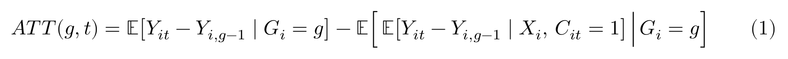
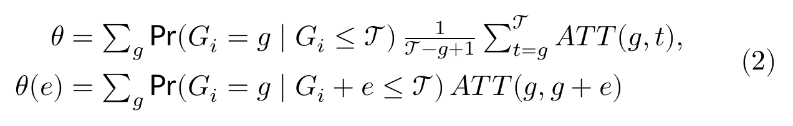
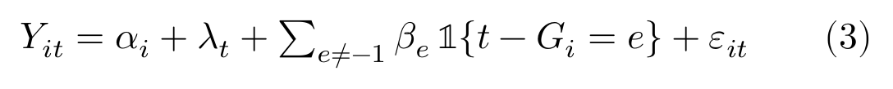

::: {.content-visible when-format="pdf"}
```{=latex}
\begin{center}
{\bfseries Descripción de la metodología}\\[3pt]
{\itshape Andrés Álvarez, Fernando Barba, Luis Islas}
\end{center}
\vspace{-6pt}
```
:::

::: {.content-visible when-format="docx"}
::: {custom-style="Centrado"}
**Descripción de la metodología**

*Andrés Álvarez, Fernando Barba, Luis Islas*
:::
:::

# Título

¿Atrajo o desplazó? Efectos de la expansión del Banco del Bienestar sobre la presencia de la banca
privada en los municipios de México, 2019–2024

# Pregunta central

Entre 2019 y 2024 el Banco del Bienestar pasó de 540 sucursales heredadas de Bansefi a unas 3,150,
abiertas por etapas (Comisión Nacional Bancaria y de Valores [CNBV], 2025). Queremos saber si la
llegada de la primera sucursal del banco a un municipio aumentó o redujo la presencia de la banca
privada, es decir, de los bancos comerciales (banca múltiple) y de las cooperativas y financieras
populares (entidades de ahorro y crédito popular, EACP). También queremos saber si el efecto fue
distinto en los municipios que no tenían banca múltiple.

# Objetivos causales y predictivos

El objetivo es causal; no haremos predicción. Usaremos diferencias en diferencias con adopción
escalonada (Callaway y Sant'Anna, 2021): compararemos cómo cambian los municipios que reciben su
primera sucursal con cómo cambian, en los mismos trimestres, los que todavía no la reciben. Un
municipio queda tratado desde el primer trimestre en que opera una sucursal del banco según la
CNBV, sin contar las de Banjército, que en estos datos aparecen junto con el banco. Usamos la fecha
de operación y no la de obra porque no coinciden: al cierre de 2022 había 1,873 sucursales
terminadas y solo 922 operando (Auditoría Superior de la Federación [ASF], 2023). El tratamiento es
la llegada de la primera sucursal; no estimaremos el efecto de sucursales adicionales, porque la
mayoría de los municipios recibe solo una.

La identificación depende de tres supuestos. El primero son tendencias paralelas: sin la sucursal,
los municipios tratados habrían cambiado igual que los controles con las mismas covariables. Lo
revisaremos con los efectos estimados antes de la apertura, que deberían ser cero, y con la
sensibilidad de Rambachan y Roth (2023), que indica cuánto tendría que fallar el supuesto para
cambiar la conclusión. El segundo es que no haya anticipación. Como la obra se veía antes de abrir,
repetiremos la estimación suponiendo un trimestre de anticipación. El tercero es que no haya
derrames hacia los municipios de control; si los hay, el efecto estimado se acerca a cero, y con
datos municipales no podemos descartarlos del todo.

# Modelos estadísticos

Usaremos un panel trimestral 2019T1–2024T4 de los 2,456 municipios del país. De ese total
quitamos 487 que ya tenían sucursal en 2019T1, 8 cuya apertura podría ser de Banjército y 4 que
abrieron entre 2019 y 2021 en grupos de menos de cinco. Quedan 1,457 tratados, que abren entre
2022T1 y 2024T1 con al menos 12 trimestres de datos previos, y 500 que no abren antes de 2025.

El resultado principal, $Y_{it}$, es una tasa: sucursales privadas (banca múltiple más EACP) por
cada 10 mil adultos del municipio $i$ en el trimestre $t$, con la población adulta fija en 2022T4
porque la CNBV cambia su fuente en 2020T4. Mide la oferta, no cuántas personas usan la banca. Los
secundarios son la tasa de banca múltiple y la de EACP. La primera etapa son las sucursales totales
y las cuentas del banco, que no usamos como resultado porque suben por construcción al pagar
programas sociales.

Sea $G_i$ el trimestre de la primera sucursal del municipio $i$ ($G_i=0$ si no abre). El efecto en
el trimestre $t$ para los municipios que abren en $g$ es

::: {.content-visible when-format="pdf"}
$$
\begin{aligned}
ATT(g,t)={}&\mathbb{E}\big[Y_{it}-Y_{i,g-1}\mid G_i=g\big]\\
&-\mathbb{E}\Big[\,\mathbb{E}\big[Y_{it}-Y_{i,g-1}\mid X_i,\,C_{it}=1\big]\,\Big|\,G_i=g\Big]
\end{aligned}
$$ {#eq-att}
:::

::: {.content-visible when-format="docx"}
::: {custom-style="Centrado"}
{width=5.83in}
:::
:::

El primer término es el cambio de la tasa en los que abren en $g$ entre el trimestre previo a abrir
($g-1$) y $t$; el segundo, el que habrían tenido sin sucursal según los municipios que en $t$ aún no
abren ($C_{it}=1$) con las mismas covariables $X_i$, todas previas a las aperturas: el logaritmo de
la población, el índice de marginación de 2020 (Consejo Nacional de Población [CONAPO], 2021) y si
había banca múltiple en 2019T1. Lo estimaremos con el método doblemente robusto de Callaway y
Sant'Anna (2021), que combina una regresión lineal con un puntaje de propensión; basta con que uno
de los dos sea correcto.

Resumiremos los $ATT(g,t)$ en dos medidas:

::: {.content-visible when-format="pdf"}
$$
\begin{aligned}
\theta&=\textstyle\sum_g \Pr(G_i=g\mid G_i\le\mathcal{T})\,\frac{1}{\mathcal{T}-g+1}\sum_{t=g}^{\mathcal{T}}ATT(g,t),\\
\theta(e)&=\textstyle\sum_g \Pr(G_i=g\mid G_i+e\le\mathcal{T})\,ATT(g,g+e)
\end{aligned}
$$ {#eq-agregados}
:::

::: {.content-visible when-format="docx"}
::: {custom-style="Centrado"}
{width=4.24in}
:::
:::

donde $\mathcal{T}$ = 2024T4 es el último trimestre y $e$ son los trimestres desde la apertura.
$\theta$ promedia cada grupo sobre sus trimestres después de abrir y pondera los grupos por su
tamaño, así que mezcla exposiciones de uno a tres años. $\theta(e)$ es el estudio de evento: con
$e<0$ revisa si había diferencias antes de abrir y con $e\ge0$, si el efecto crece con el tiempo.

Agruparemos los errores estándar por municipio y probaremos $H_0:\theta=0$; para las tendencias
previas, $\theta(e)=0$ para todo $e<0$ en una prueba conjunta. Ajustaremos por pruebas múltiples
entre los tres resultados (Romano y Wolf, 2005). Solo concluiremos que no hubo efecto si el
intervalo al 90% queda dentro de ±5% de la media previa (±0.05 sucursales por cada 10 mil adultos).

Como comparación estimaremos el estudio de evento de dos vías:

::: {.content-visible when-format="pdf"}
$$Y_{it}=\alpha_i+\lambda_t+\textstyle\sum_{e\neq-1}\beta_e\,\mathbb{1}\{t-G_i=e\}+\varepsilon_{it}$$ {#eq-twfe}
:::

::: {.content-visible when-format="docx"}
::: {custom-style="Centrado"}
{width=3.63in}
:::
:::

donde $\alpha_i$ y $\lambda_t$ son efectos fijos de municipio y de trimestre, $\beta_e$ es el efecto
$e$ trimestres después de abrir ($e=-1$ es la referencia) y $\varepsilon_{it}$ es el error. No es
el modelo principal porque, con aperturas escalonadas y efectos distintos, usa como controles a
municipios que ya abrieron (Goodman-Bacon, 2021). También estimaremos con un trimestre de
anticipación, solo con los nunca tratados como controles y sin los grupos desbalanceados.

# Aprendizajes del análisis empírico

El signo de $\theta$ distingue tres hipótesis. Habrá atracción ($\theta>0$) si el banco acerca a
hogares sin cuenta y esa demanda atrae a bancos y cooperativas privadas. Así lo sugieren la
expansión del antecesor de Bansefi, que aumentó el ahorro de hogares de bajos ingresos (Aportela,
1999), la de Banco Azteca, que aumentó los negocios informales (Bruhn y Love, 2014), y las de India
y Brasil (Burgess y Pande, 2005; Fonseca y Matray, 2024). Habrá desplazamiento ($\theta<0$) si una
red pública subsidiada compite por los mismos clientes, sobre todo con las cooperativas rurales. Y
no habrá efecto ($\theta\approx0$) si el banco, que casi no dio crédito (ASF, 2023), solo sirve para
pagar programas sociales; abrir cuentas no garantiza que se usen (Dupas et al., 2018).

La primera etapa dirá si el acceso cambió. Si los efectos antes de la apertura no son cero,
tomaremos el resultado como descriptivo y no como causal. El diseño tiene límites: no dirá nada de
los 487 municipios que ya tenían sucursal, no separará el efecto de la sucursal del de la obra o de
los programas sociales, y mide la oferta de servicios financieros, no su uso.

# Heterogeneidad en efectos de tratamiento o en predicciones

Estimaremos el modelo por separado en grupos definidos antes de las aperturas, cada uno con sus
propios controles, y compararemos los efectos con una prueba $z$. Como son varias comparaciones,
controlaremos la tasa de falsos descubrimientos (Benjamini y Hochberg, 1995). La dimensión principal
es la segunda pregunta: los municipios sin banca múltiple en 2019T1, que son la mayoría. Ahí
esperamos más atracción, porque no hay a quién desplazar. También compararemos por marginación,
tamaño de población y sector (banca múltiple contra EACP). Por último, $\theta(e)$ dirá si el efecto
crece con el tiempo que lleva abierta la sucursal, como esperaríamos si es causal.



# Referencias {.unnumbered}

```{=latex}
\begingroup\setlength{\parindent}{-1.5em}\setlength{\leftskip}{1.5em}\setlength{\parskip}{4pt}
```

::: {custom-style="Referencias"}

Aportela, F. (1999). *Effects of financial access on savings by low-income people* [Manuscrito no
publicado]. Banco de México.

Auditoría Superior de la Federación. (2023). *Control interno y gobernanza del Banco del Bienestar,
S.N.C., I.B.D.* (Auditoría combinada de cumplimiento y desempeño 2022-2-06HJO-21-0018-2023, Cuenta
Pública 2022). <https://www.asf.gob.mx/Trans/Informes/IR2022c/Documentos/Auditorias/2022_0018_a.pdf>

Benjamini, Y., & Hochberg, Y. (1995). Controlling the false discovery rate: A practical and powerful
approach to multiple testing. *Journal of the Royal Statistical Society: Series B (Methodological),
57*(1), 289–300. <https://doi.org/10.1111/j.2517-6161.1995.tb02031.x>

Bruhn, M., & Love, I. (2014). The real impact of improved access to finance: Evidence from Mexico.
*The Journal of Finance, 69*(3), 1347–1376. <https://doi.org/10.1111/jofi.12091>

Burgess, R., & Pande, R. (2005). Do rural banks matter? Evidence from the Indian social banking
experiment. *American Economic Review, 95*(3), 780–795. <https://doi.org/10.1257/0002828054201242>

Callaway, B., & Sant'Anna, P. H. C. (2021). Difference-in-differences with multiple time periods.
*Journal of Econometrics, 225*(2), 200–230. <https://doi.org/10.1016/j.jeconom.2020.12.001>

Comisión Nacional Bancaria y de Valores. (2025). *Bases de Datos de Inclusión Financiera* [Conjunto
de datos]. <https://www.gob.mx/cnbv/acciones-y-programas/bases-de-datos-de-inclusion-financiera>

Consejo Nacional de Población. (2021). *Índices de marginación 2020* [Conjunto de datos].
<https://www.gob.mx/conapo/documentos/indices-de-marginacion-2020-284372>

Dupas, P., Karlan, D., Robinson, J., & Ubfal, D. (2018). Banking the unbanked? Evidence from three
countries. *American Economic Journal: Applied Economics, 10*(2), 257–297.
<https://doi.org/10.1257/app.20160597>

Fonseca, J., & Matray, A. (2024). Financial inclusion, economic development, and inequality:
Evidence from Brazil. *Journal of Financial Economics, 156*, 103854.
<https://doi.org/10.1016/j.jfineco.2024.103854>

Goodman-Bacon, A. (2021). Difference-in-differences with variation in treatment timing. *Journal of
Econometrics, 225*(2), 254–277. <https://doi.org/10.1016/j.jeconom.2021.03.014>

Rambachan, A., & Roth, J. (2023). A more credible approach to parallel trends. *The Review of
Economic Studies, 90*(5), 2555–2591. <https://doi.org/10.1093/restud/rdad018>

Romano, J. P., & Wolf, M. (2005). Stepwise multiple testing as formalized data snooping.
*Econometrica, 73*(4), 1237–1282. <https://doi.org/10.1111/j.1468-0262.2005.00615.x>
:::

```{=latex}
\endgroup
```
