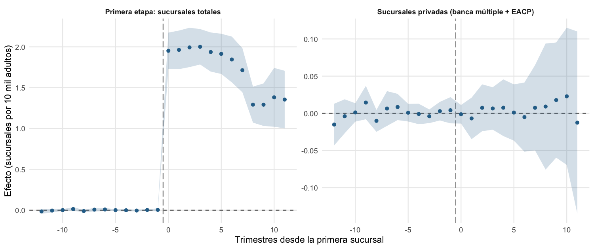
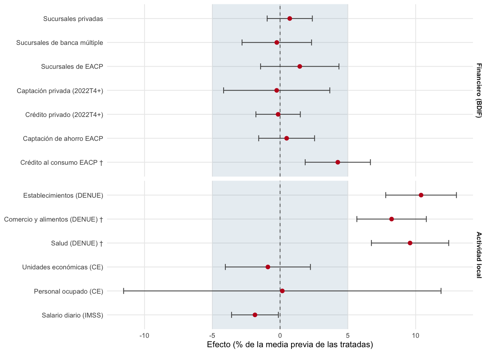
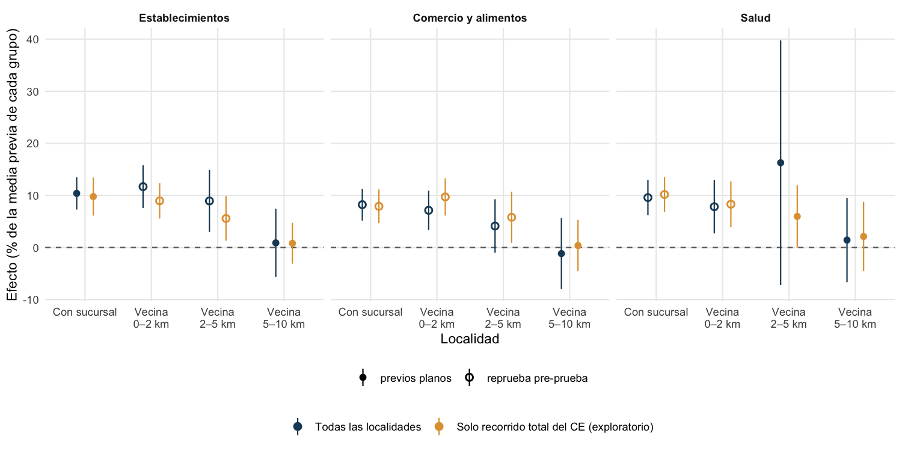
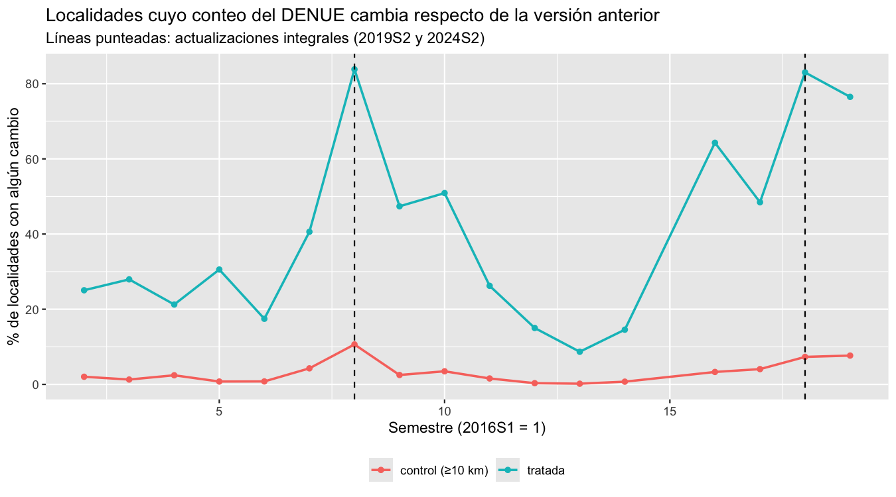

## La política y la pregunta

- 2019: Bansefi se convierte en el **Banco del Bienestar** (540 sucursales). Meta: **2,744** nuevas,
  construidas por la SEDENA; al cierre de 2022, **922 operando** (ASF 2023).
- El banco **casi no prestó**: su función fue dispersar programas sociales.

. . .

> ¿La primera sucursal **atrajo o desplazó** a la banca privada —banca múltiple y cooperativas y
> financieras populares (EACP)—? ¿Fue distinto donde no había banca? ¿Cambió la actividad económica?

## Datos y diseño

- **Tratamiento:** primer trimestre con una sucursal del banco **en operación** (BDIF, CNBV), sin
  Banjército.
- **1,457 municipios tratados** contra 500, aperturas escalonadas 2022–2024.
- **Callaway y Sant'Anna (2021)**, doblemente robusto; ee agrupados por municipio; Romano–Wolf;
  HonestDiD.
- **Nulo informativo** solo si el IC90 queda dentro de ±5%. Todo **preregistrado**.

## Primera etapa: el banco abrió cuentas

{width=100%}

**+3,284 tarjetas del banco por 10 mil adultos** en las 1,457 tratadas, con previos planos. En sus
cajeros, ~**1 transacción por tarjeta cada dos meses**: el calendario de pago de los programas.

## Banca privada: ni atracción ni desplazamiento

::: {style="font-size: 62%"}

:::

- Igual con casi todas las **regresiones de efectos fijos**, otros controles, placebo de fecha y sin
  derrames.
- **Sin diferencias** por desierto bancario (q ≥ 0.6).

## Resumen de efectos

{height=600}

## DENUE: +10% que no es de la sucursal

{width=78%}

- El DENUE solo se actualiza por completo con los **Censos de 2019 y 2024**.
- **Sin dosis** (2022 ≈ 2023–24), **efecto de zona** (vecinas a menos de 2 km igual) y **ausente
  en los Censos** municipales (−0.9%).

## Conclusiones

1. El banco **bancarizó** en cuentas propias; en sus cajeros, el uso sigue el pago de los programas.
2. **No atrajo ni desplazó** a la banca privada (se descarta ±2.4% en sucursales privadas).
3. El +10% del DENUE **no se comporta como efecto** de la sucursal.
4. **Política:** importa qué ofrece la sucursal (crédito, ahorro), no solo dónde está.

## Gracias {.center}

Todo es reproducible desde el repositorio: `make bateria` y `make entregables`. Preregistro y
decisiones: `docs/decisiones.md`.

## Respaldo: el DENUE casi no se mide entre censos

{height=430}

- Solo las versiones **11/2019 y 11/2024** se actualizan por completo con los Censos Económicos.
- Diseño **entre actualizaciones**: estimando en 2024S2, placebo en 2019S2.

## Respaldo: DENUE y actividad económica

::: {style="font-size: 62%"}

:::

- **Régimen censal**: no explica el aumento (+9.8% dentro del recorrido total).

## Respaldo: heterogeneidad por desierto bancario

::: {style="font-size: 75%"}

:::

- DENUE: mayor en desiertos bancarios, la dirección que predice la literatura.

## Respaldo: robustez

- **DiD apilado** (Wing et al. 2024): mismo nulo financiero.
- Anticipación, nunca tratados, sin covariables, cohortes grandes, cluster estatal, 2025,
  pre-periodo desde 2016 y sin cierres: **el nulo no cambia**.
- HonestDiD: aguanta violaciones de un cuarto de las previas; con suavidad, −4.0% a +2.2% (tres
  primeros trimestres).

## Respaldo: fuentes adicionales (fase 2)

::: {style="font-size: 60%"}

:::

- Preregistradas el 7 de octubre, fuera de las familias del texto principal.
- **Emprendimiento en personas** (EIC 2015/2020/2025): sin aumento; el +10% del DENUE es del
  **padrón**.
- **Luz nocturna**: sin cambio. **Banjército observado** (Portafolio CNBV): mismo nulo financiero.

## Respaldo: efectos fijos y controles (fase 4) {.scrollable}

::: {style="font-size: 50%"}

:::

- Preregistrada el 14 de octubre. **Mismo nulo con regresiones de efectos fijos**, otros grupos de
  control, placebo de fecha y HonestDiD con suavidad.
- **Excepción:** el TWFE extendido con covariables (+6.8%). CS con el mismo ajuste lineal, +2.1%;
  solo por calendario, +1.3%. Una atracción pequeña queda menos acotada que el desplazamiento.
- **Bancarización:** +3,284 tarjetas del banco por 10 mil adultos; ~1 transacción por tarjeta cada
  dos meses en sus cajeros.
  La ENIGH no tiene potencia para uso ni bienestar.

## Respaldo: delitos y elecciones (fase 3) {.scrollable}

::: {style="font-size: 50%"}

:::

- Preregistradas el 11 de octubre, fuera de las familias del texto principal.
- **Delitos** (SESNSP 2019–2025): previos planos y efecto ≈ 0, pero **no informativo** (no
  descarta ±12–50%). Son denuncias, no delitos.
- **Elecciones** (INE 2015–2024, una cohorte): la pre-prueba **falla**; sin efecto identificado.
